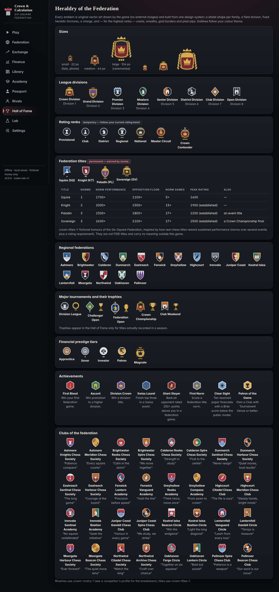
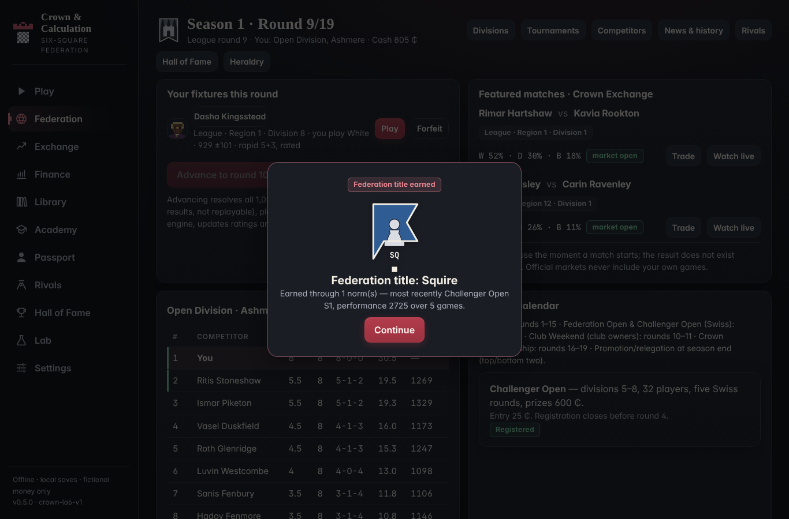
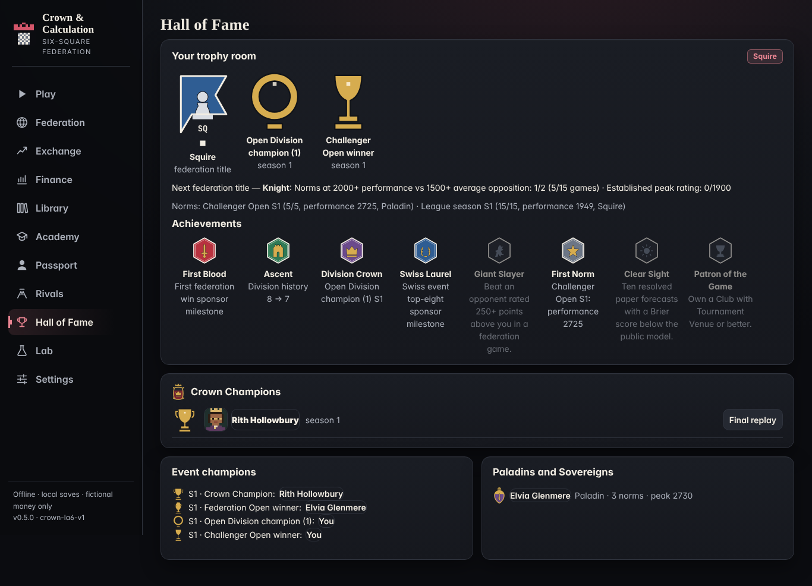
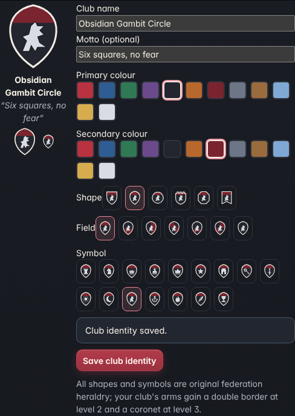

# M5 addendum — The Living Rivalry & Heraldry System

Scope note: this addendum was delivered on its own; the main v0.5.0 "Sovereign Dynasty" prompt it refers to was
not provided. The addendum is therefore implemented on top of v0.4.0 "The Grand Exchange", wired into the same
federation service, ledger, save format and UI, and it changes nothing about engine strength, ratings, markets
or offline behaviour (see *Verification*).

Model ids: emblems `crown-heraldry-1`, titles `crown-titles-1`, rivalries `crown-rivalry-1`, featured rivals
`crown-rivals-1`, clubs `crown-clubs-1`. All are pure functions of recorded data and are covered by tests.

## 1. Emblem design system (`src/heraldry/`)

Every emblem is an `EmblemSpec` rendered by one SVG component (`src/ui/Emblem.tsx`). No raster files, no
external image services, no emoji. A spec is:

| Part | Values |
|---|---|
| Shape (silhouette) | heater, kite, roundel, lozenge, banner, cartouche, octagon, tower, pennant, hexagon |
| Field division | plain, pale, fess, bend, chevron, quarterly, chief, saltire, pily |
| Tinctures (fixed palette) | or, argent, gules, azure, vert, sable, purpure, tenné, sanguine, celeste, bronze, steel |
| Charge (central symbol) | rook, knight, queen, king, pawn, crown, star, tower, sword, key, scales, coin, sun, moon, hourglass, flame, anchor, quill, chalice, book, laurel, gate, griffin |
| Border | single, double, pixel (gold pixel-stepped edge — the "pixel accent" of the top tiers) |
| Crest / wreath / pips | crown, coronet, star, helm; laurel wreath; 0–5 pixel pips |
| Prestige 0–5 | drives border, crest, wreath and glow; strictly increasing along every ladder (tested) |

Sizes: **sm 22 px** (lists, phone tables), **md 44 px**, **lg 104 px** (profiles, ceremonies). Families use
distinct silhouettes so they stay recognisable at 22 px: divisions = heater shields, ranks = roundels,
federation titles = lozenge/octagon with crests, regions = banners, tournaments = cartouche crests, clubs =
player/AI-chosen shapes, achievements = hexagons. Outlines and highlights use theme variables
(`--her-line`, `--her-outline`, `--her-shine`) so emblems follow Obsidian & Crimson (default), Midnight & Gold
and Ivory & Slate; tinctures are fixed so arms keep their identity across themes.

Families in the catalogue (`src/heraldry/catalog.ts`): 8 league divisions, 7 rating ranks (Provisional →
Crown Contender), 4 federation titles, 16 regional federations, 5 tournaments with crests and trophies
(Crown Championship grand trophy, Federation Open amphora, Challenger goblet, league plate, Club Weekend cup),
5 financial prestige tiers, 8 achievements, 32 AI clubs, personal insignia for every competitor. The gallery
(`#/heraldry`, Heraldry button on the World screen) renders every family.

## 2. Federation titles (`crown-titles-1`) — fictional, norm-based

Research: real chess titles reward *sustained* performance rather than a single result. FIDE awards GM/IM
titles for a combination of **norms** (tournament performances over a minimum number of games against a
qualifying field, usually summing to at least 27 games) **and** a minimum rating; e.g. a GM norm needs a
performance of about 2600 and the title also needs a 2500 rating ([Wikipedia: Norm (chess)](https://en.wikipedia.org/wiki/Norm_(chess)),
[FIDE Title Regulations 2022](https://handbook.fide.com/chapter/B012022), [FIDE Title Regulations 2024](https://handbook.fide.com/chapter/B012024),
[chess.com on GM norm requirements](https://www.chess.com/news/view/fide-grandmaster-title-mishra-karjakin-areshchenko-malinin),
[US Chess forum discussion of norm counts](https://forum.uschess.org/t/how-many-norms-for-fide-titles/19218)).
Sources differ on details (number of norms, opponent rating floors), so we copied only the *structure*.

The Six-Square Federation's titles are explicitly fictional, carry no meaning outside the game, and are not
FIDE titles:

| Title | Norms | Norm performance | Opp. average floor | Norm games | Peak rating | Also |
|---|---|---|---|---|---|---|
| Squire (SQ) | 1 | 1700+ | 1100 | 5 | 1600 | — |
| Knight (KT) | 2 | 2000+ | 1500 | 15 | 1900 established (RD ≤ 100) | — |
| Paladin (PL) | 3 | 2300+ | 1800 | 27 | 2200 established | an event title |
| Sovereign (SV) | 3 | 2600+ | 2100 | 27 | 2500 established | a Crown Championship final |

A norm is one finished event with at least 5 games: performance = average opponent rating + dp, with
dp = −400·log₁₀(1/p − 1) capped at ±800 (the Elo inverse). Norms are computed when the Swiss events end
(round 8), when the league ends (round 15) and when the Crown Championship ends, for the player and for every
competitor, from recorded games. Titles are permanent and never lost. They are separate from league
positions and from the (temporary) rating ranks.

## 3. Featured rivals (`crown-rivals-1`)

28 of the 2,048 competitors are featured and persisted in `world.featured` at federation creation (or on first
load of an older save): the top Crown Division player of each of the 16 regions, the 8 highest-rated players
of divisions 1–2 elsewhere ("legends"), and the 4 highest-rated players of the player's starting division
("your circle" — the rivals the player actually meets in season 1). Each has a stable portrait, personal
insignia, club, career history, style (only validated styles are shown as styles; others are labelled), an
ambition derived from their record, reputation and recorded titles. Rivals screen: `#/rivals`.

## 4. Rivalries (`crown-rivalry-1`)

Rivalries are computed on demand from recorded games, knockout results and season finishes — never stored as
free-floating numbers, never used by pairings, results, ratings, engines or markets.

| Event | Points |
|---|---|
| Meeting (draw / decisive) | +2 / +3 — only the first 2 meetings of a pair per season count (anti-farming) |
| Upset (winner rated ≥150 below) | +6, once per pair per season |
| Knockout elimination | +12 (Crown Championship +18) |
| Championship rematch | +10 |
| Meetings in consecutive seasons (3rd season on) | +5 |
| Promotion battle (both top-3 of the same division) | +8 |
| Streak of 3 wins | +5 |

Points decay ×0.7 per season; intensity is capped at 100. Levels: Acquaintance, Rival (10+), Nemesis (30+),
Arch-rival (60+). Every point is listed with its event on the competitor profile.

## 5. Clubs (`crown-clubs-1`)

* **Your club**: buy a Starter Chess Club (Finance → Institutions), then open *Club identity*: name (2–32
  characters), primary/secondary colour from the palette, shield shape, field division, symbol, motto (≤ 48).
  Validated, persisted with the club asset, shown on Finance and the Hall of Fame. Arms gain a double border at
  level 2 and a pixel border with coronet at level 3.
* **AI clubs**: 32 clubs (two per region) with arms and mottos unique by construction (tested). Each active
  competitor belongs to one club of their region (stable hash of their id). Club treasuries are ledger
  accounts `club:<id>`: season-end dues of 5% of members' balances (`club-dues:<season>`) and 60% operating
  costs to the sink (`club-ops:<season>`). All balanced journals; the ledger stays conserved.
* Names, shapes and symbols are original; nothing imitates a real team or club.

## 6. Spectacle

* **Ceremonies** (`src/ui/Ceremony.tsx`): federation title earned, event title won, promotion, and the season's
  Crown Champion(s). Created only inside the round commit from recorded results, with deterministic ids
  (`fed-title:<title>`, `championship:<season>`, …) so they can never be awarded twice; marked seen when
  dismissed. Animations are CSS-only and disabled under `prefers-reduced-motion`.
* **Hall of Fame** (`#/hall`): your trophy room (federation title insignia, one trophy per recorded title,
  achievements with evidence, next-title progress and norms), Crown Champions by season with portraits, the
  grand trophy and the final's replay where it was a featured game, event champions, Paladins and Sovereigns.
* **World screen**: division insignia in standings, tournament crests, champion trophies, a rivalry preview
  for upcoming championship ties.

## 7. Discovery and following

Competitors screen filters: rating range, division, federation title, validated style, club, rivalry with you,
achievements (titled), and "has an upcoming fixture". Profiles have *Follow career* (favourites, persisted)
next to the Exchange watchlist; the profile's *This season* panel follows their league position, Swiss events
and Crown Championship progress.

## 8. Verification

Unit tests: `tests/heraldry.test.ts` (ladders distinct with strictly increasing prestige; every spec renders a
self-contained SVG at every size with no external references; personal insignia distinct; title rules and
performance formula; rivalry bounded, anti-farming, decay, upsets, purity; clubs unique and valid; 28 featured
rivals stable) and `tests/heraldryService.test.ts` (a full simulated season: featured rivals persist, federation
titles from norms, unique ceremonies, club journals balanced, identity survives reload; recomputing
rivalries does not change any result).

Acceptance journey: see *Acceptance results* below.

## Acceptance results (re-run on the final v0.5.0 build, 2026-11-03)

`npm run build && node e2e/m5-heraldry.mjs` — headless Chromium on Linux, fresh profile, real UI clicks; the
"human" is a scripted robot (Crown engine, 12k nodes) playing every fixture through the board. Log:
[evidence/m5-heraldry/journey-log.txt](evidence/m5-heraldry/journey-log.txt). **11 / 11 passed**, 0 console or
page errors. (The first run, on the M5 addendum build, also passed 11/11; its log was replaced by this run.)

| # | Step | Result |
|---|---|---|
| 1 | View all league and rank insignia | Gallery: 8 division, 7 rank, 4 title, 16 regional, 5 financial, 8 achievement, 32 club emblems; 91 SVGs, 0 broken, 0 external images; rendered in 51 ms |
| 2 | Open a featured rival's profile | one of 28 featured ("your circle"); personal, division, club and region insignia |
| 3 | Play a match that changes a rivalry record | league game vs that featured rival, won; rivalry went from no meetings to a recorded meeting |
| 4 | View the updated head-to-head | "Acquaintance · 3/100 · 1–0–0 … You beat … (+3, S1)" on the profile |
| 5 | Follow a rival's tournament | *Follow career* on; profile shows their live league position and title progress |
| 6 | Customise the club emblem | name, motto, sable/sanguine, kite, griffin — saved and re-read from the save |
| 7 | Enter a major championship | **Challenger Open** (major Swiss event, field average ≈ 1,970): 5/5. The Crown Championship itself needs Crown Division qualification, which a new player cannot reach in season 1, so it was watched, not entered |
| 8 | Win an earned title | **Squire**: Challenger norm (performance 2725 over 5 games) + league norm + peak rating 2159 |
| 9 | See the championship ceremony | 5 ceremonies, each shown and dismissed: federation title, Crown Champion (season 1), Open Division champion, Challenger Open winner, promotion; exactly one championship award, no duplicate ids |
| 10 | View the trophy in the Hall of Fame | trophy room: Squire insignia + 2 event trophies; Crown Champions row with portrait, grand trophy and final replay |
| 11 | Restart with everything preserved | browser closed and reopened: featured rivals, norms, title, ceremonies, favourites, club identity, every balance, every competitor's titles/norms, rating — identical (56,143-character snapshot) |

Phone (390 × 844): heraldry, rivals, rival profile, Hall of Fame, finance, world: no horizontal overflow; each
screen ready in 28–167 ms in this container. Emblems at 22 px stay distinguishable by silhouette and charge
(screenshots `m-*.png`). Not tested: a physical iPhone or Windows machine.

Screenshots (docs/evidence/m5-heraldry/): 01-gallery, 02-rivals, 03-rival-profile, 04-h2h-updated, 05-following,
06-club-editor, 07-challenger-registered, 07b-swiss-standings, ceremony-fed-title, ceremony-championship,
ceremony-event-title, ceremony-promotion, 10-hall, m-heraldry, m-rivals, m-rival-profile, m-hall, m-finance, m-world.

### Known limits

* The robot wins almost every game in season 1 (the bottom division is weak against it), so this journey shows the
  happy path; the unit tests cover the no-norm and capped cases.
* Norm performance uses opponents' ratings at the end of the event (decision H04).
* The rules allow an exceptional AI competitor to reach Paladin or even Sovereign in the first season (three
  high norms over 27 games plus the honour requirement). Across journey runs, a competitor reached Sovereign or Paladin in season 1. Whether that is too fast is a balance question
  left open.
